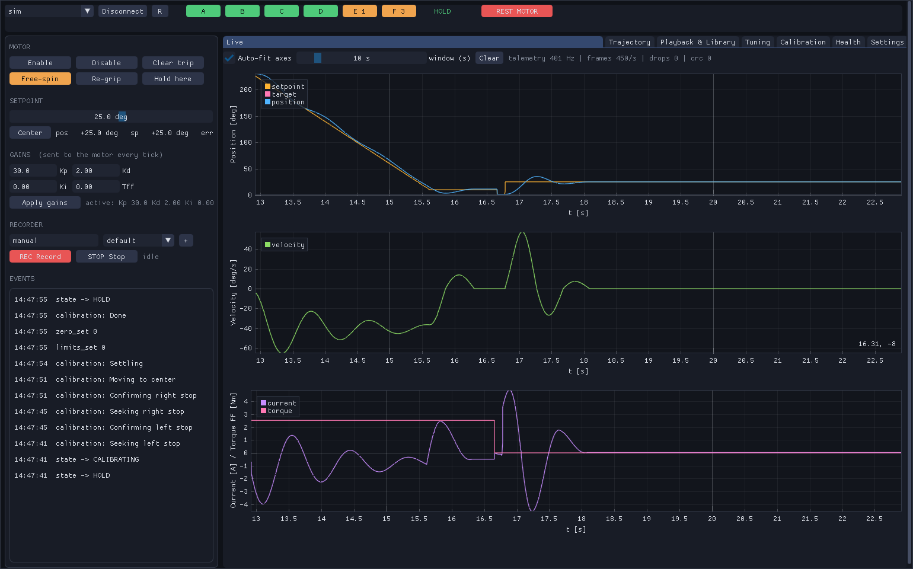

# Gen Auto — Steering Actuator

Firmware + PC software for the Gen Auto steering robot: a Yobotics **BM-18** quasi-direct-drive
actuator bolted to a car's steering wheel, driven by a **Teensy 4.1** over CAN, supervised from a
laptop running a **Python (Dear PyGui) desktop app**, with an optional Arduino joystick/RF bridge and
an optional phone for synced video/IMU capture.

This is the v2 rewrite of the original `steering_tuner` / `MotorControlWebGUI` software. Same hardware,
new architecture: **every subsystem and link has a health node with a reason, every control is gated by
those nodes, every recording carries its own evidence, and the firmware owns safety.**


## What it does

| Task | How |
|---|---|
| Find the steering end stops and set zero at the exact centre | **Calibration → Auto-calibrate** (firmware routine, bounded torque, confirms stops against friction) |
| Record a steering motion by hand | **Enable → Free-spin → Record**, turn the wheel, **Stop** |
| Replay it on the motor, compare runs | **Playback & Library → Play back** — creates `<name>_pb01…`, linked to the parent, with metrics |
| Tune the loop | **Tuning → Step test / Relay auto-tune** → proposed gains → Apply |
| Know *why* something isn't working | Top-bar **A–F boxes** → **Health** tab (node, reason, what it blocks, fix) → `data/logs/` |
| Capture phone video / IMU in sync with a recording | **Settings → run hub**, open the URL on the phone, arm camera |

## Quick start

```bash
# 1. firmware (PlatformIO)
cd firmware/teensy && pio run -e teensy41 -t upload          # wired (USB) build
cd ../arduino_bridge && pio run -e uno -t upload              # optional joystick/RF bridge

# 2. PC app
cd pc && pip install -e ".[server,dev]"
python -m steering ui                 # auto-connects to the Teensy
python -m steering ui --sim           # no hardware: full app against the built-in simulator
python -m pytest                      # end-to-end tests run against the simulator
```

First run, in the app: **Connect** → close the idle switch (B1 green) → **Calibration → Auto-calibrate**
→ **Enable** → drag the setpoint slider. Everything else is reachable from the tabs; if a button is
greyed out, hover it: the tooltip lists the exact health nodes blocking it.



## Repository map

```
protocol/            protocol.h  — THE wire contract (framing, packet structs, enums); logo bitmap
firmware/teensy/     config.h (all tunables) · can_motor · control (1 kHz ISR, trips, calibration, tests)
                     · health · comms · display · main        [PlatformIO]
firmware/arduino_bridge/  joystick + NRF24 bridge + 0.96" OLED      [PlatformIO]
pc/steering/         protocol.py (mirror, tested against the header) · link · bus
   health/           model.py (every node, documented) · evaluator · gating (every action's requirements)
   core/             app (composition, housekeeping, shutdown→REST) · controller (gated actions) · settings
   control/          trajectories (generators, from_recording) · streamer (200 Hz)
   data/             store (folders + SQLite catalog) · recorder · analysis (metrics, relay/step, trim)
   server/           hub (FastAPI/WS: phones & future devices) · devices/ (interface for throttle etc.)
   ui/               Dear PyGui app · gate binder · safe callbacks · panels/
   sim.py            fake Teensy + fake BM-18 behind the same Transport interface (fault injection)
pc/tests/            protocol sync, end-to-end flows on the simulator, hub
pc/tools/ui_smoke.py scripted headless UI session (used to make docs/screenshots)
phone/index.html     phone capture page (camera, IMU, NTP-style time sync)
docs/                ARCHITECTURE · HARDWARE · PROTOCOL · HEALTH · SAFETY · DATA · OPERATIONS · MIGRATION · ROADMAP
scripts/             check_firmware.sh (host g++ type-check of the firmware)
```

## Documentation

* [ARCHITECTURE](docs/ARCHITECTURE.md) — goal → problems → solutions → tasks; compute & comm; control cascade; state machine
* [HARDWARE](docs/HARDWARE.md) — electrical system, pinout, CAN bus, BM-18 datasheet facts
* [PROTOCOL](docs/PROTOCOL.md) — framing, packets, CAN frames
* [HEALTH](docs/HEALTH.md) — the status bar explained, root-cause walkthrough, OLED legend; [generated node reference](docs/HEALTH_REFERENCE.md)
* [SAFETY](docs/SAFETY.md) — trips, layers, what happens when each thing dies
* [DATA](docs/DATA.md) — folders, naming, lineage, metrics, logs
* [OPERATIONS](docs/OPERATIONS.md) — procedures and debugging
* [MIGRATION](docs/MIGRATION.md) — what changed from the old code and why (bugs found)
* [ROADMAP](docs/ROADMAP.md) — throttle robot, multi-device, phone IMU

## Status

* Firmware: compiles cleanly under the host type-check (`scripts/check_firmware.sh`); PlatformIO build
  not run in this environment (no cross toolchain) — see MIGRATION §"Verify on hardware".
* PC: 12 tests pass against the simulator; the UI smoke script drives every tab headlessly.
* Hardware assumptions are identical to the previous build (pins in `firmware/teensy/src/config.h`).
