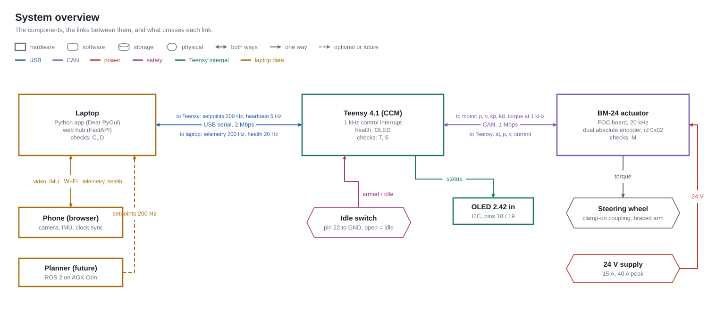
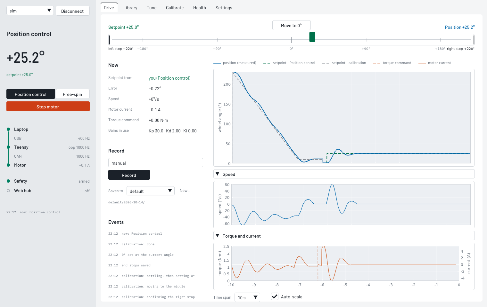
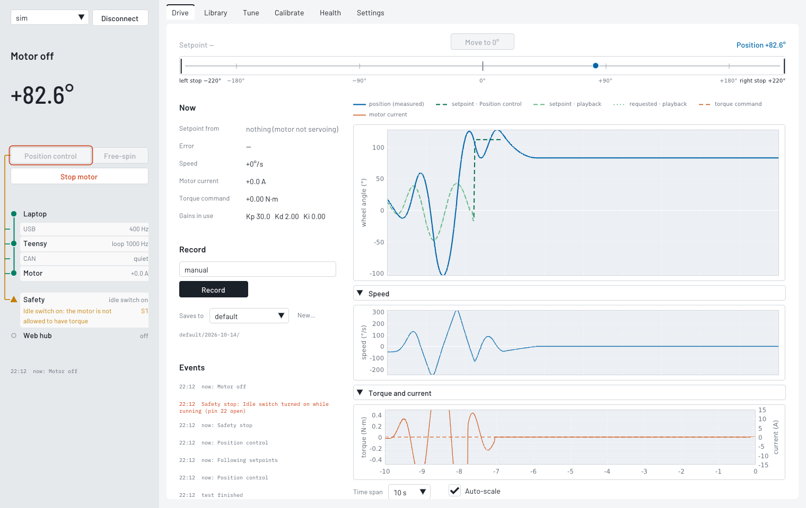
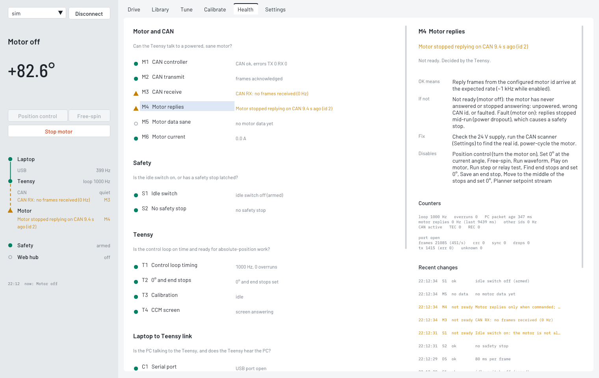
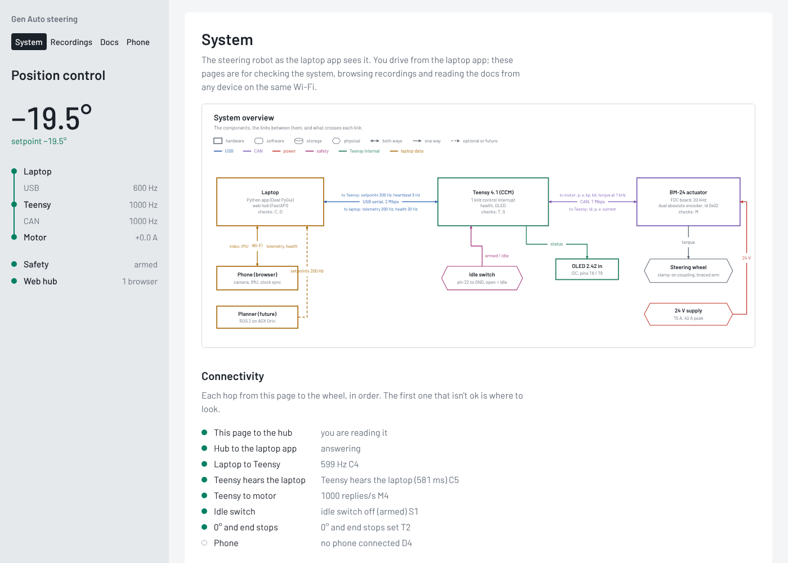

# Gen Auto — Steering Actuator

Firmware + laptop software for the Gen Auto steering robot: a Yobotics **BM-series** QDD actuator
(BM-24 per the project page, see HARDWARE) clamped to a car's steering wheel, driven by a **Teensy 4.1**
over CAN (the "CCM"), supervised from a laptop running a **Python desktop app** (Dear PyGui), with an
optional **web hub** (browser UI for status / recordings / docs, phone video+IMU capture, planner input).



## What it does

| Task | How |
|---|---|
| Know what state everything is in | The **rail** on the left of the app: the state in words, the wheel angle, and the signal chain Laptop, USB, Teensy, CAN, Motor, Safety, Web hub. A row that isn't OK says which check failed and why (checks are named by kind: **C** link, **S** safety, **M** motor and CAN, **T** Teensy, **D** data) |
| Know *why* a button is grey | Hover it: the tooltip says why, and lines run from the button to the rail rows it depends on. The **Health** page explains every check (what OK means, what it means when it isn't, the fix) |
| Find the steering end stops and make the middle 0° | **Calibrate → Find end stops and set 0°** (firmware routine, bounded torque) |
| Hold an angle / move the wheel | **Position control** in the rail, then drag the setpoint slider on **Drive** (or **Move to 0°**, which sits above 0° on the scale; the blue dot under the slider is where the wheel really is) |
| Record a steering motion by hand | **Free-spin** in the rail, **Drive → Record**, turn the wheel, **Stop recording** |
| Replay it on the motor and compare runs | **Library → Play on motor**: creates `<name>_pb01…` linked to the parent, with results |
| Tune the loop | **Tune → Step test / Relay test** → proposed gains → **Send gains**, with the live response beside it |
| Browse data / read docs from any device | **[nikhil-k-v.github.io/genauto-steering](https://nikhil-k-v.github.io/genauto-steering/)** — docs work anywhere; with **Settings → Run the web hub** on, enter the laptop's address (or scan the QR in Settings) to see live status and recordings over the Wi-Fi |
| Phone video / IMU synced to a recording | same hub, **Phone capture** page |
| Let the vehicle stack (ROS 2 / Orin) steer | hub `setpoint` stream → same gating as a trajectory |

## Quick start

```bash
# firmware (PlatformIO)
cd firmware/teensy && pio run -t upload

# laptop app
cd pc && pip install -e ".[server,dev]"
python -m steering ui                 # auto-connects to the Teensy
python -m steering ui --sim           # no hardware: whole app against the built-in simulator
python -m steering ui --sim --data ../examples/sim_data   # same, with example recordings to browse
python -m pytest                      # end-to-end tests on the simulator
```

First run: **Connect** → turn the idle switch off (Safety row `armed`) → **Calibrate → Find end stops and set 0°**
→ **Position control** → drag the setpoint slider on **Drive**. Hover anything for a second to see what it does;
if it is grey, the tooltip says exactly why.






The look follows a few rules: names say what the motor does ("Position control", never "Hold"); a problem
says what is physically wrong ("Idle switch on", "Motor stopped replying on CAN 2.1 s ago (id 2)"); colour means
status, picked to survive red-green colour blindness, and every status mark also has a shape (● ok, ▲ not
ready, ■ fault); plot lines are solid when measured, dashed for the setpoint and dotted for what was requested,
coloured by where the setpoint came from. Barlow for the interface, DejaVu Sans in plots, a mono only for machine text.

## Repository map

```
protocol/            protocol.h — THE wire contract (framing, packets, enums); splash bitmap
firmware/teensy/     config.h (all tunables) · can_motor · control (1 kHz ISR, trips, calibration, tests)
                     · health · comms · display · main          [PlatformIO]
pc/steering/         protocol.py (mirror, tested against the header) · link · bus · sim (fake Teensy+motor)
   health/           model.py (every check, documented) · evaluator · gating (every action's requirements)
   core/             app (composition, housekeeping, shutdown→REST) · controller (gated actions) · settings
   control/          trajectories · streamer (200 Hz)
   data/             store (folders + SQLite catalog) · recorder · analysis
   server/           hub (FastAPI/WS: web UI, phone, planner) · devices/ (interface for the throttle robot)
   ui/               Dear PyGui app · rail (state + signal chain) · dependency overlay · gate binder · panels/ · fonts/
web/index.html       browser UI: served by the hub, and published to GitHub Pages (pc/tools/build_pages.py,
                     .github/workflows/pages.yml) where it connects to the laptop over the Wi-Fi
phone/index.html     phone capture page (camera, IMU, time sync)
docs/                guides + docs/diagrams/gen.py (generates every SVG) + screenshots
examples/sim_data/   example recordings made with the simulator (pc/tools/make_sim_data.py)
scripts/             check_firmware.sh (host g++ type-check); pc/tools/ui_smoke.py (headless UI session)
```

## Documentation

* [ARCHITECTURE](docs/ARCHITECTURE.md) — goal → problems → solutions; compute & comms; control cascade; states
* [HARDWARE](docs/HARDWARE.md) — electrical system, pinout, CAN, motor facts
* [PROTOCOL](docs/PROTOCOL.md) — framing, packets, CAN frames
* [HEALTH](docs/HEALTH.md) — every check explained, root-cause walkthrough; [generated node reference](docs/HEALTH_REFERENCE.md)
* [SAFETY](docs/SAFETY.md) — trips and layers
* [DATA](docs/DATA.md) — folders, lineage, metrics, logs
* [OPERATIONS](docs/OPERATIONS.md) — procedures and debugging
* [MIGRATION](docs/MIGRATION.md) — what changed from the old code and why; hardware verification checklist
* [ROADMAP](docs/ROADMAP.md)

All of these are also served, with the diagrams, by the web hub under **Docs**.

## Status

* Firmware: host type-check clean (`scripts/check_firmware.sh`); PlatformIO build/flash still to be run on
  hardware — see MIGRATION "Verify on hardware".
* PC: tests pass against the simulator; `pc/tools/ui_smoke.py` drives every tab headlessly and produced the
  screenshots above.
