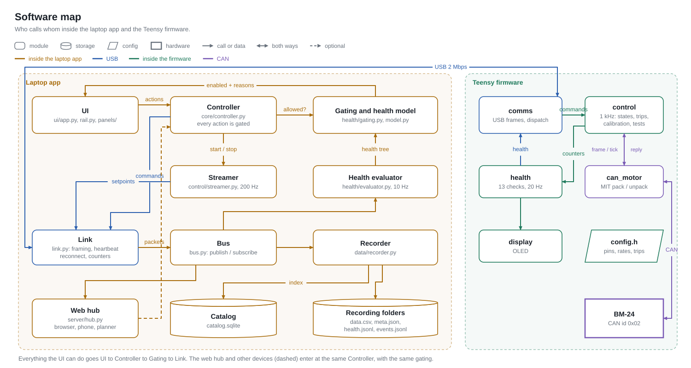
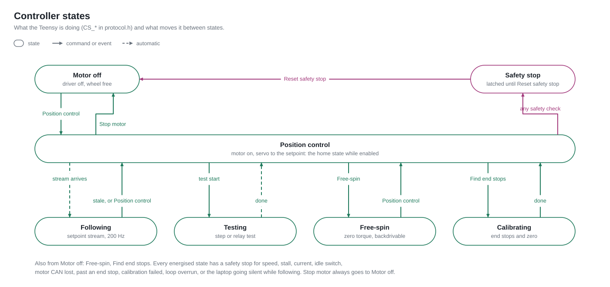
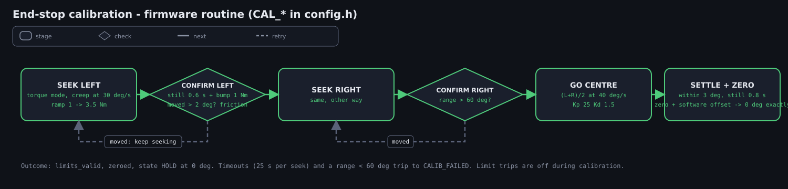

# Architecture

## 1. Goal → problems → solutions

**Goal.** Drive a real steering wheel through aggressive / drift trajectories that come from research
motion planners — repeatably, safely, and with evidence of what actually happened on every run.
Context (nkve.dev/pages/genauto): a universal, non-destructive steering robot (clamps to any wheel by hand
in ~1 min, < $500 in parts); first maneuver target **J-turns for collision avoidance**, then autonomous
drifting; perception and planning run in ROS 2 on an NVIDIA AGX Orin; a **zero-torque mode** lets a human
drive with the robot attached and record maneuvers for playback; the safety driver can take over at any
time.

| Problem | Why it is hard | Solution in this repo |
|---|---|---|
| A steering column has high, variable friction and hard end stops | Pure PD leaves steady-state error; hitting a stop with gain = damage | Cascaded control (§3) with a Teensy-side leaky integral; firmware-owned limits with margin; auto end-stop calibration (§5) |
| Three computers and several links can each fail silently | "Motor doesn't move" has ~20 root causes | Health tree (docs/HEALTH.md): every link and subsystem is a node with a state, a reason and the actions it blocks; shown as the signal chain in the app's rail; controls are literally wired to the rail rows they depend on |
| Trajectories must be captured, replayed and compared | Files scattered, playbacks unlinked, no context when something went wrong | Store with lineage (docs/DATA.md): playbacks are children of their recording; every recording carries metrics, gains, limits, health snapshots and the event log |
| A crash or lost link must never leave torque applied | PC software is the least reliable part | Firmware owns safety (docs/SAFETY.md): trips, slew/gain ramps, switch + liveness gating, REST on PC loss; the app cannot crash from a callback and always sends DISABLE on exit |
| More devices are coming (throttle robot, phones, planner) | A web GUI in the control loop adds latency and failure modes | The laptop app owns the Teensy link; an optional hub beside it exposes the same bus/controller to browsers, phones and the planner (§6) |

## 2. Compute and communication

| Node | Role | Rate / link |
|---|---|---|
| **BM-series actuator** | FOC current/position loop, dual absolute encoder | 20 kHz internal; CAN 1 Mbps, MIT-style 8-byte frames |
| **CCM / Teensy 4.1** | 1 kHz control ISR, safety trips, calibration & test state machines, health nodes M/S/T, OLED | USB serial 2 Mbps to the laptop (framed) |
| **Laptop** | desktop app (control surface), gating, streaming setpoints, recording, analysis, catalog, web hub | 200 Hz setpoints out, 200 Hz telemetry in, 20 Hz health, 5 Hz heartbeat |
| **Browser / phone** | status, recordings, docs; camera, IMU, clock sync | Wi-Fi HTTP + WebSocket to the hub |
| **Planner (ROS 2 / Orin)** | desired steering angle | hub `setpoint` stream (gated like a trajectory) |

Key decisions:

* **One wire contract.** `protocol/protocol.h` is the single source of truth; `pc/steering/protocol.py`
  mirrors it and `tests/test_protocol_sync.py` parses the header to prove they agree. Frames are
  `[AB CD len seq payload crc8]`.
* **In-process bus on the laptop.** `bus.py` is a tiny pub/sub; link → bus → (evaluator, recorder, UI, hub).
  Nothing talks to the serial port but `Link`.
* **Gating is one function.** `health/gating.py::can(action)` is called by the UI (to disable + explain +
  draw the dependency lines) and by the controller (to refuse), so what is disabled and what is refused
  never disagree. Remote clients go through the same controller.
* **Firmware decides firmware facts.** Nodes M/S/T are computed on the Teensy from its own counters and
  packed into `HealthPacket.node_states`; the PC only displays them. PC-side facts (C, D) are computed on
  the PC; a summary is relayed back in the heartbeat for the OLED.

## 3. Control cascade

* **Motor (20 kHz):** `τ = kp·(p* − p) + kd·(v* − v) + τ_ff`; `kp`, `kd` are sent every tick in the frame.
* **Teensy (1 kHz ISR, `control.cpp`):** resolves the mode, clamps the target to the active limits, slews
  the command, ramps gains after any (re)grip, adds a leaky clamped integral + feed-forward as `τ_ff`,
  runs the trips, sends exactly one CAN frame. It is the **only** CAN writer: the main loop queues
  enter/exit/zero "specials" and the ISR sends them on the next tick.
* **Laptop (200 Hz, `control/streamer.py`):** streams `SetpointPacket`s from a `Trajectory` (generator,
  resampled recording, or live planner input), after clipping to limits and blending in from the current
  position with a 0.6 s cosine so the wheel never jumps.

## 4. Health (status) architecture

See docs/HEALTH.md. `HealthEvaluator` runs at 10 Hz, merges firmware nodes with PC nodes, logs every
transition, publishes the tree; the recorder writes snapshots + transitions + events into every recording.

## 5. Calibration (end stops + zero)

Firmware state machine (`run_calibration` in `control.cpp`), parameters `CAL_*` in `config.h`:
velocity-regulated torque creep to each stop (never above `CAL_SEEK_TORQUE_MAX_NM`), a bump to confirm
the stop against friction, slew to the centre, settle, zero — with a software offset so the measured centre
is exactly 0°. Manual fallback: capture L / capture R in free-spin → go-centre-zero; or type limits.

## 6. Web hub, phones, planner, other devices

The hub (`server/hub.py`, FastAPI + WebSocket) is optional and sits beside the desktop app, never between
it and the Teensy. It serves:

* `/` — browser UI (`web/index.html`): the same rail, the system diagram, a hop-by-hop connectivity check, recordings browser with
  traces / metrics / events / video, data handling (pin, rename, notes, tags, hide), the docs with diagrams.
* `/phone` — phone capture (camera, IMU, NTP-style sync into the active recording's folder).
* `/ws` — JSON stream (telemetry 20 Hz, health 2 Hz, events, recording state) and, with *allow remote
  control*, `{"type":"setpoint","pos_deg":…}` from the planner at up to 200 Hz →
  `Controller.external_setpoint` (same gating as a trajectory; firmware falls back to position control (HOLD) if
  the stream stops).
* `/api/...` — REST for recordings, health and docs; `/api/info` lists the addresses other devices can use,
  `/api/qr.svg` draws a QR code for one.

**Reaching it over the Wi-Fi.** The same `web/index.html` is published to GitHub Pages
(`pc/tools/build_pages.py`, `.github/workflows/pages.yml`) with the docs pre-rendered, so docs work with no
hub. An https page may call `http://localhost` (browsers treat loopback as secure) but not a plain-http
device on the LAN, so: on the laptop itself the Pages copy talks to the hub in place (the hub's CORS allows
exactly the Pages origin, including Chrome's private-network preflight); on any other device it hands over
to the laptop's own copy at `http://<ip>:8765/`. `?hub=<ip>:8765` in the Pages URL (Settings shows it as a
link and a QR code) makes that one tap, and the address is remembered. With `zeroconf` installed the hub
also answers as `genauto.local` (mDNS), which survives DHCP changing the laptop's IP. The WebSocket accepts
browsers only from its own pages and the Pages origin (non-browser clients send no Origin and are allowed),
so another website open in the same browser cannot drive the hub.

Future devices (throttle robot) implement `devices/base.py::Device` — health nodes with a group letter of
their own, timestamped samples the recorder writes next to `data.csv`, gated actions.

## 7. Failure handling, in one place

| What dies | Who notices | What happens |
|---|---|---|
| Motor power / CAN | Teensy (M4 FAIL) | `TRIP_CAN_LOST` → REST; everything needing the motor greys out |
| Idle switch opened | Teensy (S1) | `TRIP_SWITCH_OPENED` → REST; Enable refused with reason |
| PC app crashes / UI stalls | link thread keeps the heartbeat but drops `HB_UI_ALIVE` if frames stall > 1 s; `atexit`/signals send DISABLE | FOLLOWING → `TRIP_PC_LINK_LOST`; TEST → ends, HOLD |
| USB unplugged | PC (C1/C2), Teensy (C5) | as above; PC reconnect loop with backoff |
| UI callback raises | `ui/safe.py` | logged with traceback, toast, D5 reason; UI keeps running |
| Recorder disk slow | D1 FAIL | counted drops; never silently truncated |
| Teensy ISR overruns | T1 | BLOCKED/FAIL; ≥ `ISR_OVERRUN_TRIP` per period → DISABLE |
