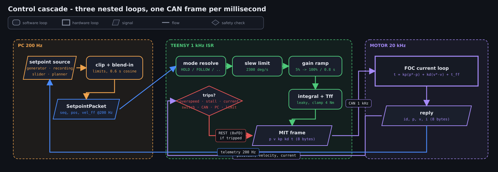

# Architecture

## 1. Goal → problems → solutions → tasks

**Goal.** Drive a real steering wheel through aggressive / drift trajectories that come from research
motion planners — repeatably, safely, and with evidence of what actually happened on every run.

**Problems this system has to solve**

| Problem | Why it is hard | Solution in this repo |
|---|---|---|
| A steering column has high, variable friction and hard end stops | Pure PD leaves steady-state error; hitting a stop with gain = damage | Cascaded control (§3) with a Teensy-side leaky integral; firmware-owned limits with margin; auto end-stop calibration with a bounded-torque creep and a "bump" confirmation (§5) |
| Three computers and four links can each fail silently | "Motor doesn't move" has ~20 root causes | Health tree A–F (`docs/HEALTH.md`): every link and subsystem is a node with a state, a reason and the actions it blocks; same tree on both OLEDs and the UI |
| Trajectories must be captured, replayed and compared | Files scattered, playbacks unlinked, no context when something went wrong | Store with lineage (`docs/DATA.md`): playbacks are children of their recording; every recording carries metrics, gains, limits, health snapshots and the event log |
| A crash or lost link must never leave torque applied | PC software is the least reliable part | Firmware owns safety (`docs/SAFETY.md`): trips, slew/gain ramps, heartbeat + idle-switch gating, REST on PC loss; the PC app cannot crash from a callback and always sends DISABLE on exit |
| More devices are coming (throttle robot, phones) | A web GUI in the loop adds latency and failure modes | Laptop stays the compute + the Teensy link; an optional hub beside it exposes the same bus/controller to other devices (§6) |

**Tasks (what a person actually does)** — see `docs/OPERATIONS.md`.

## 2. Compute and communication

| Node | Role | Rate / link |
|---|---|---|
| **BM-18** | FOC current/position loop, dual absolute encoder | 20 kHz internal; CAN 1 Mbps, MIT-style 8-byte frames |
| **Teensy 4.1** | 1 kHz control ISR, safety trips, calibration & test state machines, health nodes A–E, OLED | USB serial 2 Mbps to the PC (framed); NRF24 to the bridge |
| **Laptop** | UI, gating, streaming setpoints, recording, analysis, catalog, hub | 200 Hz setpoints out, 200 Hz telemetry in, 20 Hz health, 5 Hz heartbeat |
| **Arduino Uno** | joystick (100 Hz), RF bridge, second OLED with the same A–F boxes | NRF24 2 Mbps; optional USB |
| **Phone** | camera, IMU, NTP-style clock sync | Wi-Fi HTTP + WebSocket to the hub |

Key decisions:

* **One wire contract.** `protocol/protocol.h` is the single source of truth. Both firmware targets include it; `pc/steering/protocol.py` mirrors it and `tests/test_protocol_sync.py` parses the header to prove they agree (ids, enums, struct sizes). Frames are `[AB CD len seq payload crc8]`; over NRF24 only the payload is sent (the radio provides boundaries + CRC). All payloads ≤ 32 bytes so one packet is one radio frame.
* **In-process bus on the PC.** `bus.py` is a tiny pub/sub; link → bus → (evaluator, recorder, UI, hub). Any new consumer (a device, a logger) subscribes; nothing talks to the serial port but `Link`.
* **Gating is one function.** `health/gating.py::can(action)` is called by the UI (to grey out + explain) and by the controller (to refuse), so what is disabled and what is refused never disagree. Remote clients go through the same controller.
* **Firmware decides firmware facts.** Nodes A1–E1 are computed on the Teensy from its own counters and packed into `HealthPacket.node_states`; the PC only *displays* them. PC-side facts (port, framing, round trip, recorder, store, hub, UI loop) are D/F nodes computed on the PC. The Teensy relays the F summary to its OLED via the heartbeat.

## 3. Control cascade

* **Motor (20 kHz):** `τ = kp·(p* − p) + kd·(v* − v) + τ_ff`. `kp`, `kd` are sent every tick in the MIT frame and run inside the motor.
* **Teensy (1 kHz ISR, `control.cpp`):** resolves the mode, clamps the target to the active limits, slews the command (`SETPOINT_SLEW_DEG_S`), ramps gains after any (re)grip (`GAIN_RAMP_*`), adds a leaky clamped integral (`KI_*`) + feed-forward as `τ_ff`, runs the safety trips, and sends exactly one CAN frame. It is the **only** CAN writer: the main loop queues "special" frames (enter/exit motor mode, zero) and the ISR sends them on the next tick — this is what fixed the reentrant-driver CAN death in the old code.
* **PC (200 Hz, `control/streamer.py`):** a monotonic-scheduled thread streams `SetpointPacket`s from a `Trajectory` (generator or resampled recording), after clipping to limits and blending in from the current position with a 0.6 s cosine so the wheel never jumps.

Modes resolve from what data is fresh (mode request is sticky): a fresh setpoint stream ⇒ TRAJ, fresh joystick ⇒ JOY, else HOLD. Tests (step/relay) and calibration run *on the Teensy* for exact timing; the PC only starts them and records.

## 4. Health (status bar) architecture

* Nodes are declared once in `pc/steering/health/model.py` with name, what OK means, what bad means, how to fix, and which actions they affect; `docs/HEALTH_REFERENCE.md` is generated from it.
* `HealthEvaluator` runs at 10 Hz, merges firmware nodes with PC nodes, logs every transition to `data/logs/health-YYYY-MM-DD.jsonl` (+ a full snapshot every 10 s), and publishes the tree.
* The `Recorder` writes health snapshots (1 Hz + transitions) and all events into the recording folder, and keeps the worst nodes seen as `health_summary` in the catalog, so a bad run can be root-caused later.

## 5. Calibration (end stops + zero)

Firmware state machine (`run_calibration` in `control.cpp`), parameters `CAL_*` in `config.h`:

1. **Seek left:** torque mode, push toward the stop; torque ramps *up* while the wheel moves slower than `CAL_SEEK_VEL_DEG_S` and *down* when faster, so it creeps at a bounded speed with the least torque that beats friction (never above `CAL_SEEK_TORQUE_MAX_NM`).
2. **Confirm left:** when the wheel has been still for `CAL_STILL_MS` with torque ≥ `CAL_CONFIRM_TORQUE_NM`, push a bit harder (`CAL_CONFIRM_BUMP_NM`). If it moves more than `CAL_MOVE_MIN_DEG` it was friction → keep seeking; else it is the stop → record.
3. Same to the right. Range sanity (`CAL_MIN_RANGE_DEG`), per-stage timeouts (`CAL_MAX_SEEK_MS`) → `TRIP_CALIB_FAILED`.
4. **Go centre:** position mode with gentle gains, slewed at `CAL_CENTER_RATE_DEG_S`.
5. **Settle & zero:** when within `CAL_SETTLE_TOL_DEG` and still, send the motor's zero command and set a software offset so the measured centre is *exactly* 0° (friction may leave the wheel a degree short). Limits become symmetric about 0 and `zeroed`/`limits_valid` go true → HOLD.

Manual fallback: capture L / capture R (in free-spin) → go-centre-zero; or type limits.

## 6. Device hub and other devices

The hub (`server/hub.py`) is optional and sits *beside* the UI, never between the UI and the Teensy. It subscribes to the same bus and calls the same controller, so a remote action is gated identically. Phones get a JSON stream (telemetry 20 Hz, health 2 Hz, events, recording state), NTP-style ping/pong time sync, and upload video + IMU into the active recording's folder. Remote control is limited to a safe allow-list unless enabled.

Future devices (throttle robot, a second steering unit) implement `devices/base.py::Device` — health nodes with a group letter of their own, timestamped samples the recorder writes next to `data.csv`, and gated actions. See `docs/ROADMAP.md`.

## 7. Failure handling, in one place

| What dies | Who notices | What happens |
|---|---|---|
| Motor power / CAN | Teensy (A4 FAIL) | `TRIP_CAN_LOST` → REST; UI greys everything that needs the motor |
| Idle switch opened | Teensy (B1) | `TRIP_SWITCH_OPENED` → REST; Enable refused with reason |
| PC app crashes / UI stalls | link thread keeps the heartbeat but drops `HB_UI_ALIVE` if frames stall > 1 s; `atexit`/signal handlers send DISABLE | Teensy: TRAJ → `TRIP_PC_LINK_LOST` (REST); TEST → ends, HOLD |
| USB unplugged | PC (D1/D2), Teensy (D1) | Teensy: as above; PC: reconnect loop with backoff |
| UI callback raises | `ui/safe.py` | logged with traceback, toast, F5 reason; UI keeps running |
| Recorder disk slow | F1 FAIL | counted drops; recording not silently truncated |
| Teensy ISR overruns | C1 | health BLOCKED/FAIL; ≥ `ISR_OVERRUN_TRIP` per period → DISABLE |
