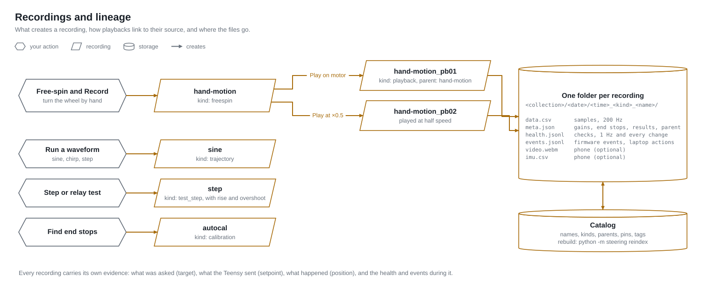

# Data: recordings, lineage, metrics, logs



## Folder layout (two levels, by design)

```
data/
  settings.json
  catalog.sqlite                      index over the folders below (safe to delete: `python -m steering reindex`)
  logs/
    app.log, app.log.YYYY-MM-DD       application log (daily rotation, 30 days)
    health-YYYY-MM-DD.jsonl           health transitions + 10 s snapshots
  recordings/
    <collection>/                     user-defined: "default", "drift-tests", "tuning", …
      <YYYY-MM-DD>/                   automatic
        <HHMMSS>_<kind>_<name>/       one recording
          data.csv                    samples (header comment + columns below)
          meta.json                   everything the catalog knows (schema 2)
          health.jsonl                health snapshots (1 Hz) + transitions during the recording
          events.jsonl                firmware events + PC actions during the recording
          video.webm / capture.json   phone video + its start time relative to the recording (optional)
          imu.csv                     phone IMU samples, t_rel_s relative to the recording (optional)
```

Pick the collection under **Record** on the Drive page (**New collection** creates one). The date folder is automatic.

## Kinds and naming

| kind | made by | name |
|---|---|---|
| `manual` | **Record** on Drive, in any state | what you typed |
| `freespin` | **Record** while in free-spin (a hand motion) | what you typed |
| `trajectory` | Tune → Test waveforms | waveform name (`sine`, `chirp`…) |
| `playback` | Library → **Play on motor** | **`<parent name>_pbNN`**, `parent_uid` = the recording played; NN counts that parent's playbacks |
| `test_step`, `test_relay` | Tune → step / relay test | `step`, `relay` |
| `calibration` | Calibrate → Find end stops and zero | `autocal` |

Playbacks are children: Library shows them indented under their parent, the parent's
`playback_count` sorts the "playbacks" view, and `meta.json` of both sides carries the link.

## `data.csv` columns

| column | unit | source |
|---|---|---|
| `t_s` | s, from recording start (PC monotonic clock) | PC |
| `t_teensy_us` | µs, Teensy `micros()` | Teensy |
| `ctrl_state` | `CS_*` | Teensy |
| `flags` | `TF_*` bits | Teensy |
| `target_deg` | what the PC asked for this tick (blank when not streaming) | PC streamer |
| `setpoint_deg` | what the Teensy actually commanded after limits/slew | Teensy |
| `position_deg`, `velocity_deg_s`, `current_A` | motor reply | Teensy |
| `torque_cmd_Nm` | feed-forward sent (integral + tff; relay/calibration torque) | Teensy |
| `error_deg` | `setpoint − position` (blank when not servoing) | PC |

## `meta.json`

uid · name · kind · collection · path · created_at / created_str · parent_uid · duration_s · samples ·
pinned · tags · notes · `metrics` · `health_summary` / `health_worst` · `gains` (kp kd ki tff +
limit_left/right/valid at the time) · has_video.

## Metrics (`data/analysis.py::compute_metrics`)

Always: `samples duration_s sample_rate_hz max_gap_ms err_rms_deg err_max_abs_deg err_mean_deg
err_p95_abs_deg vel_max_abs_deg_s current_max_abs_A current_rms_A pos_min/max/range_deg
tracking_score_pct` (100 % at zero error, 0 % when RMS error reaches 10 % of the setpoint range).

Step tests add `step_amp_deg step_rise_s (10–90 %) step_overshoot_pct step_settle_s (2 %) step_ss_err_deg`.
Relay tests add `relay_Tu_s relay_amp_deg relay_h_Nm relay_Ku_Nm_per_rad relay_periods`; the Tune page
turns Ku/Tu into Ziegler–Nichols / Pessen / steering-conservative proposals.

## Editing

* **Trim the end** (Library): permanently drops samples after the chosen time, recomputes results.
* Pin, rename, notes, tags, soft-delete (hidden in the catalog, files kept).
* `python -m steering reindex` rebuilds the catalog from every `meta.json` (e.g. after copying
  folders between machines).

## Phone capture alignment

`capture.json` stores `start_server_ms` (phone's estimate of the laptop clock when the camera started,
using the NTP-style offset) and `video_start_rel_s` = offset into the recording. IMU rows are already
on the recording's time base. Expect ±(jitter) ms; the phone reports its sync jitter as node D4.
