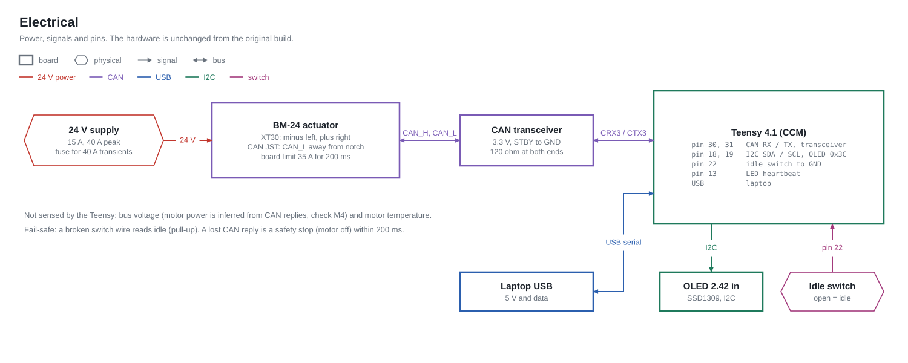

# Hardware & electrical system

Hardware is **identical to the previous build**. Pins are the single source of truth in
`firmware/teensy/src/config.h` and the top of `firmware/arduino_bridge/src/main.cpp`.

## Power

| Rail | Source | Loads | Notes |
|---|---|---|---|
| 24 V DC | bench / vehicle supply | BM-18 (XT30: − left, + right as marked on the actuator) | BM-18: 15 A rated, 40 A peak; firmware current protection on the motor board is 35 A / 200 ms. Size wiring and fusing for 40 A transients. |
| 5 V USB | laptop | Teensy 4.1 (+ OLED, NRF24 via its 3.3 V regulator) | A charge-only cable looks like "D2 silent" in the health tree. |
| 5 V USB / 9 V | laptop or battery | Arduino Uno (+ OLED, NRF24) | NRF24 wants a 10–100 µF cap across its 3.3 V pins. |

There is no bus-voltage sense on the Teensy, so "motor powered" is inferred from CAN replies
(node **A4**). If you add an ADC divider later, make it node A7.

## CAN bus

* BM-18 ↔ transceiver ↔ Teensy **CAN3** (`CRX3` pin 30, `CTX3` pin 31), 1 Mbps, standard 11-bit ids.
* Motor id **0x02** (`MOTOR_CAN_ID_DEFAULT`); changeable at run time with `CMD_SET_MOTOR_ID` (REST only) and discoverable with the scanner (Settings → Scan bus).
* 120 Ω termination at both physical ends. Error counters (TEC/REC) and fault confinement are read directly from the FlexCAN3 registers and surfaced as node **A1**.
* The actuator's CAN connector is a keyed JST — note the notch orientation in the datasheet photo (CAN_L is the pin away from the notch, CAN_H next to it).
* The datasheet's "debug port 1/2" (USB-ish serial at 921600 8N1, ST-LINK pads) is the motor's own CLI (`m c s e z p` commands) used for the motor's internal encoder calibration — not used by this firmware, but see OPERATIONS → "motor won't give sane data".

## Teensy 4.1 pinout

| Pin | Function | Node |
|---|---|---|
| 30 / 31 | CAN3 RX / TX → transceiver (STBY tied low) | A1–A5 |
| 18 / 19 | I2C SDA / SCL → SSD1309 2.42" OLED @0x3C | C4 |
| 9 / 10 | NRF24 CE / CSN; SPI0 MOSI 11, MISO 12, SCK 13 | E1 |
| 22 | **Idle switch** to GND, `INPUT_PULLUP`. LOW = closed = **ARMED**; open/broken wire = IDLE (fail-safe) | B1 |
| 13 | on-board LED heartbeat (wired mode only; shared with SCK) | — |
| USB | PC link 2 Mbps | D1–D6 |

## Arduino Uno (bridge)

| Pin | Function |
|---|---|
| 9 / 10 (HW SPI) | NRF24 CE / CSN |
| A4 / A5 | I2C → SSD1306 0.96" OLED @0x3C |
| A2 / A1 / D3 | joystick X / Y / button (pull-up) |
| USB | optional: BridgeStatus to the PC; in `uno_bridge` env also forwards PC↔Teensy frames |

## BM-18 facts used by the firmware (from the datasheet, 优宝特 BM-18)

| Item | Value | Where used |
|---|---|---|
| Rated / peak torque | 6 Nm / 18 Nm | `MOTOR_T_MIN/MAX_NM = ±18` (**was ±6 in the old code — see MIGRATION**) |
| Rated / peak speed | 200 / 300 rpm (gear 6:1) | `VELOCITY_CUTOFF_DEG_S` sits well below |
| Rated / peak current | 15 A / 40 A; board protection 35 A/200 ms | `CURRENT_CUTOFF_A = 30` |
| Command fields | p 16 b ±4π rad · v 12 b ±30 rad/s · kp 12 b 0–500 · kd 12 b 0–100 · τ 12 b ±18 Nm | `can_motor.cpp::pack_cmd` |
| Reply layout | `[id][p hi][p lo][v hi][v lo:4 | i hi:4][i lo]` — id echo in byte 0 (verified on hardware; datasheet table is off by one) | `unpack_reply` |
| Special frames | `FF FF FF FF FF FF FF FC` enter motor mode · `…FD` exit · `…FE` set zero | `SPECIAL_*` |
| Position accuracy | < 0.15° | — |
| Temperature limit | < 85 °C (no readback over CAN) | — |

## Mechanical / safety notes

* The actuator is fastened to the steering wheel and the car floor; the end stops are the car's own
  steering lock. Calibration never exceeds `CAL_SEEK_TORQUE_MAX_NM` (3.5 Nm) + the confirm bump.
* The idle switch is the human's hard gate. Keep it within reach of the driver's seat.
* `LIMIT_MARGIN_DEG` keeps commanded positions inside the measured stops; `LIMIT_TRIP_OVERSHOOT_DEG`
  trips if the wheel is *measured* beyond them (something slipped or the zero moved).
