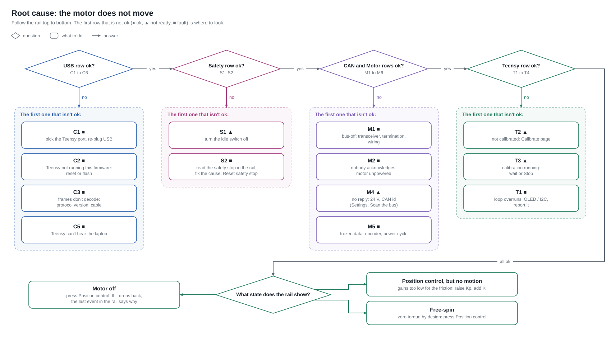

# Health: the status bar, explained

The six boxes **A B C D E F** at the top of the UI (and on both OLEDs) summarise a tree of
**health nodes**. Each node answers one question, has one of four states, carries a one-line reason,
and lists the actions it blocks. Full generated table: [HEALTH_REFERENCE.md](HEALTH_REFERENCE.md).
Definitions live in `pc/steering/health/model.py`; firmware nodes are computed in
`firmware/teensy/src/health.cpp`.

| State | Colour | Meaning |
|---|---|---|
| OK | green | working |
| BLOCKED | amber | not broken, but prevents some action (switch idle, not zeroed, calibration running, hub not started…) |
| FAIL | red | broken or tripped |
| UNKNOWN | grey | nothing observed yet (just connected, never heard from) |

A box shows its letter when the whole group is OK, or **`A4`** = "the first non-OK node in group A is
node 4". On the OLEDs: filled box = OK, hollow with `A4` = blocked/unknown, blinking hollow = FAIL.

| Group | Question | Who decides |
|---|---|---|
| **A** Motor & CAN | Can the Teensy talk to a powered, sane motor? | Teensy |
| **B** Safety | Is anything physically or by latch preventing torque? | Teensy |
| **C** Controller | Is the loop on time and ready for absolute-position work? | Teensy |
| **D** PC link | Is the PC talking to the Teensy, *and does the Teensy hear the PC*? | PC |
| **E** Bridge | Is the Arduino joystick/RF bridge alive? (optional) | Teensy + PC |
| **F** Data & services | Will what happens now be recorded, stored, served; is the UI responsive? | PC |

## How the UI uses it (item 1B)

* Every motion control is bound to an **action** in `health/gating.py`. Each frame the UI asks
  `can(action)`; if any requirement fails, the control is **disabled** and its tooltip lists the exact
  reasons (`B1 Idle switch: blocked (IDLE (switch open))`). Hovering a disabled control highlights the
  responsible group boxes in the top bar.
* The controller calls the same `can()` before sending anything, so a refusal always matches the UI.
* Independently, the **Teensy** also refuses commands it considers unsafe and replies with
  `EV_CMD_REJECTED` + reason; the UI shows that in the red banner and the Events pane.
* Some actions auto-adjust instead of refusing when it is safe: the setpoint slider follows the wheel
  when it cannot drive it; streams blend in from the current position; a finished stream leaves the
  motor in HOLD where it is.

## Root-causing "the motor doesn't move"

Read the boxes **left to right: D → B → A → C → state**. The first non-green box in that order is the
layer to fix; the Health tab row for its first bad node tells you what it means and how to fix it.

Worked example — *I pressed Enable and nothing happened*:

1. **D all green** — the PC and Teensy are talking both ways (D5 proves the Teensy heard us).
2. **B1 amber "IDLE (switch open)"** → the Enable button was already greyed with that reason. Close the
   switch. (If it reads IDLE while closed: wire to pin 22 / GND.)
3. **A4 amber "motor never replied"** → Enable is refused by both PC and Teensy with
   `no motor CAN reply`. Motor 24 V off, wrong CAN id (Settings → Scan bus), or CAN wiring (A1 red =
   bus-off = transceiver/termination; A2 red = nobody ACKs = motor unpowered).
4. All green but state stays **REST** → look at Events: the Teensy prints why it rejected
   (`tripped: clear first`, `already enabled`…).
5. State **HOLD** but the wheel doesn't follow the slider → gains vs friction (raise Kp, add Ki), or
   C2 amber (not zeroed → slider disabled).

## Where it is logged (item 1A)

| File | Content |
|---|---|
| `data/logs/health-YYYY-MM-DD.jsonl` | every node transition (`from`, `to`, `reason`) + a full snapshot every 10 s |
| `data/logs/app.log` (daily rotation) | application log: link open/close, refusals, trips, exceptions with traceback |
| `<recording>/health.jsonl` | snapshots at 1 Hz + transitions **during** the recording |
| `<recording>/events.jsonl` | firmware events (trips, rejections, calib stages, state changes) and PC actions (what was pressed, allowed or blocked and why) |
| `catalog.sqlite` → `health_summary`, `health_worst` | worst nodes seen per recording, shown in the Library list |

Analysis idea: `grep '"to": "FAIL"' data/logs/health-*.jsonl | jq` gives you every failure with its
timestamp; join on time with the recording folders to see what was running.

## Firmware nodes in detail

| Node | Computed from |
|---|---|
| A1 | FlexCAN3 `ESR1.FLTCONF` (bus-off / passive) and `ECR` TEC/REC (>96 = warning) |
| A2 | `CANbus.write()` failures per health period (>5 = FAIL), TEC > 127 = BLOCKED |
| A3 | any RX frame in the last period (motor or other id) |
| A4 | age of last reply from `MOTOR_CAN_ID`; rate vs `CAN_RX_LOW_HZ` while enabled; BLOCKED in REST (motor only answers commands), FAIL while enabled |
| A5 | NaN decode, or identical payload 200× in a row (frozen) |
| A6 | reply current vs `CURRENT_CUTOFF_A` (70 % = BLOCKED) |
| B1 | debounced pin 22 (20 ms) |
| B2 | `trip != TRIP_NONE` |
| C1 | measured ISR rate vs `CONTROL_HZ`; overruns (tick > 90 % of period) |
| C2 | `zeroed && limits_valid` |
| C3 | calibration stage |
| C4 | OLED ACKed at boot |
| D1 (Teensy's view) | PC packet age vs `PC_HEARTBEAT_TIMEOUT_MS` — surfaced on the PC as **D5** |
| E1 | bridge packet age (BLOCKED in wired mode, FAIL in wireless) |

PC nodes D1–D6, E2, F1–F5: see `health/evaluator.py` (thresholds at the top of the file).

## Adding a node

1. Add `HN_*` in `protocol.h` (and `HN_COUNT`), mirror in `protocol.py`.
2. Compute it in `health.cpp::health_update` and add it to a group in `health_groups()` **and** in
   the Arduino `draw()` group tables.
3. Declare it in `model.py` with ok/bad/fix text and the actions it affects; add it to the requirement
   lists in `gating.py` where relevant.
4. `python -m steering docs-health > docs/HEALTH_REFERENCE.md`.
